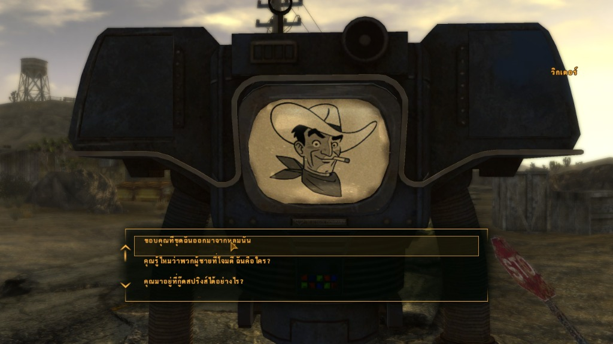
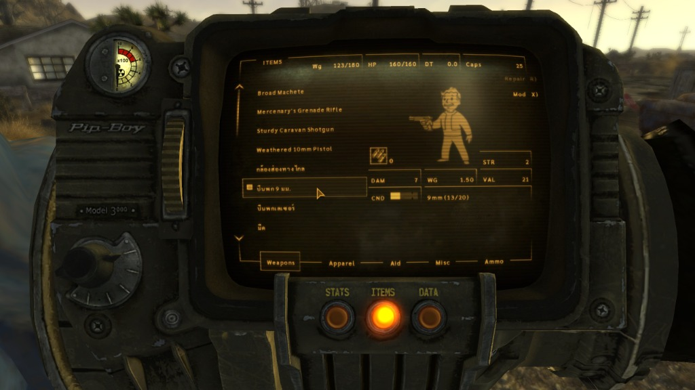
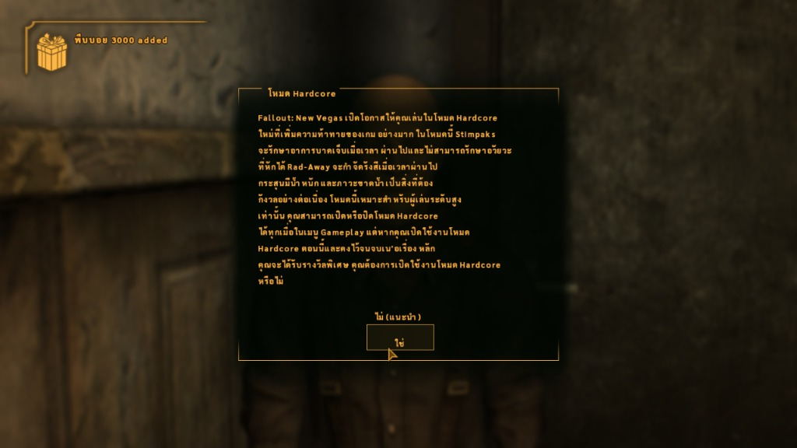
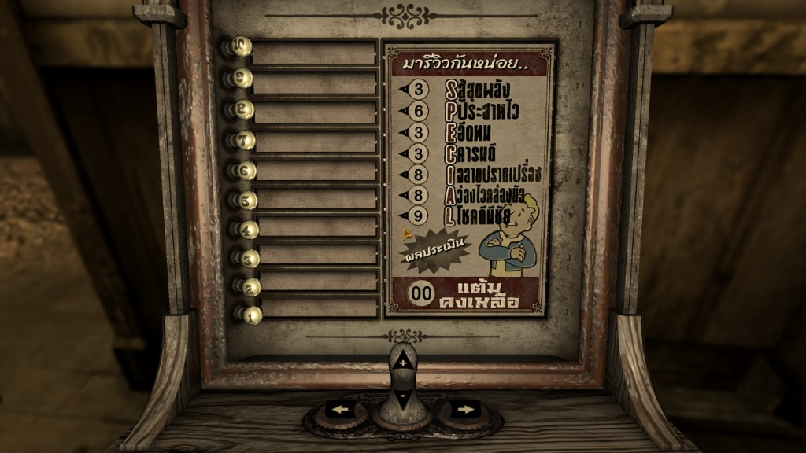

# ThaiFNV

ม็อดภาษาไทยสำหรับ **Fallout: New Vegas** (รองรับตัวเกมหลักและเนื้อหาเสริม DLC ครบทุกตัว)

---

## 📸 ผลการทดสอบล่าสุดในเกม (Latest Test Results)

ภาพบันทึกผลการทดสอบการทำงานของระบบฟอนต์ไทย, Thai Shaper Engine และข้อมูลแปลภาษาไทยภายในตัวเกมจริง:

### 1. ระบบบทสนทนาและชื่อตัวละคร (Dialogue & Topics)
แสดงผลชื่อตัวละคร (วิกเตอร์) และตัวเลือกบทสนทนาภาษาไทย วรรณยุกต์และสระบน-ล่างจัดรูปสวยงาม ไม่ซ้อนทับกัน



---

### 2. เมนูไอเทมและอุปกรณ์บน Pip-Boy 3000
แสดงรายการอาวุธและอุปกรณ์ในช่องเก็บของภาษาไทย พร้อมการจัดตำแหน่งตัวอักษรให้อยู่กึ่งกลางกรอบเลือก (Selection Box) อย่างแม่นยำ



---

### 3. กล่องข้อความแจ้งเตือนและระบบยืนยัน (Message Boxes)
หน้าต่างแจ้งเตือนและคำอธิบายระบบ (เช่น การเปิดใช้งานโหมด Hardcore) พร้อมปุ่มเลือกตอบภาษาไทย



---

### 4. เท็กซ์เจอร์และวัตถุในโลกเกม (In-World Textures)
เครื่องทดสอบสมรรถภาพ **Vigor Tester** ในบ้านของคุณหมอมิตเชลล์ (Doc Mitchell) ได้รับการแปลและวาดอักขระภาษาไทยสำหรับระบบค่าสถานะ S.P.E.C.I.A.L. อย่างครบถ้วน



---

## ✨ คุณสมบัติเด่นของระบบใหม่ (Core Highlights)

- **Thai Shaper & Precomposition Engine**: ระบบคำนวณตำแหน่งสระ-วรรณยุกต์อัตโนมัติ จัดรูปอักขระภาษาไทย (สระบน/สระล่าง/วรรณยุกต์/สระอำ) ไม่ให้เกิดปัญหาสระลอยหรือวรรณยุกต์ซ้อน
- **Calibrated Font System**: ฟอนต์ภาษาไทย (Sarabun) ที่ผ่านการคาลิเบรต Baseline Lift (+3.5px) และความกว้างตัวอักษรอย่างประณีตสำหรับทุกขนาดฟอนต์ในเกม ป้องกันปัญหาข้อความตกขอบและช่องว่างผิดสัดส่วน
- **Full Game Extraction**: สกัดข้อความครบถ้วน 100% จากเกมหลักและ DLC ทั้ง 9 ตัว รวมทั้งหมด **90,074 บรรทัด** แยกหมวดหมู่อย่างเป็นระบบ พร้อมระบุชื่อตัวละครผู้พูดในบทสนทนาได้ถึง 91%
- **Safe & Clean Integration**: แปลผ่านไฟล์ม็อดปลั๊กอิน `.esp`, แอสเซตฟอนต์ `.fnt`/`.tex` และเท็กซ์เจอร์ โดย **ไม่ทำการแก้ไขหรือแพตช์ไฟล์ `FalloutNV.exe` โดยตรง** ทำให้ไม่เกิดปัญหา Steam DRM Crash (Application load error 3:0000065432)

---

## 📁 โครงสร้างโปรเจกต์ (Repository Structure)

```
ThaiFNV/
├── docs/                   ← เอกสารโครงการ, DEVLOG และภาพผลการทดสอบ (docs/images/)
├── corpus/                 ← คลังคำศัพท์ทางการ, Backup ชีต และเครื่องมือแปล
├── extracted/
│   ├── README.md           ← สรุปสถิติและ Manifest การสกัดข้อความเกมทั้งหมด
│   ├── by_category/        ← ไฟล์ข้อความรวมแยกตาม 13 หมวดหมู่ (CSV)
│   ├── by_dlc/             ← ไฟล์ข้อความแยกโฟลเดอร์ตามแต่ละ DLC
│   └── sheets/             ← สำหรับใช้ซิงค์กับ Google Sheets / Pipeline
├── fonts/
│   ├── src/                ← ฟอนต์ต้นฉบับ TTF (Sarabun)
│   └── out/vanilla/        ← ไฟล์ฟอนต์ที่คอมไพล์แล้ว (.fnt, .png, .tex) 9 ชุด
├── pipeline/               ← เครื่องมือสกัดข้อความ, Thai Shaper, Web Studio, AI Bridge
├── release/
│   └── ThaiFNV.esp         ← ไฟล์ปลั๊กอินม็อดภาษาไทยสำหรับใช้งานในเกม
└── testing/                ← สคริปต์ทดสอบในเกมและเครื่องมือตรวจสอบผลลัพธ์
```
